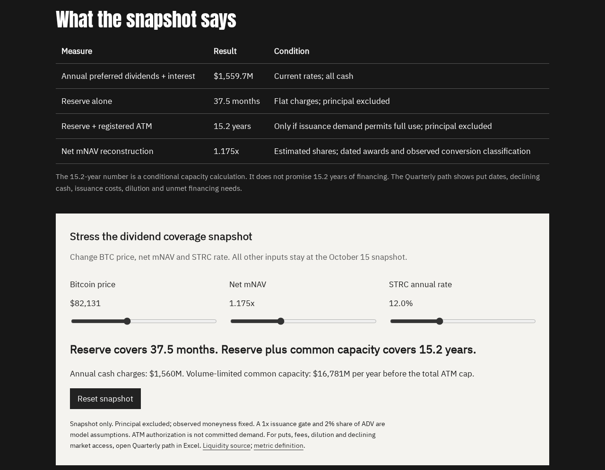

# Strategy preferred coverage model: how long cash and common stock sales can fund five preferreds

[](https://github.com/RahilBhavan/strategy-preferred-coverage-model/actions/workflows/pages.yml)

**Live:** https://rahilbhavan.github.io/strategy-preferred-coverage-model/



This Excel workbook estimates how long Strategy can pay dividends on STRF, STRC, STRE, STRK and STRD and the interest on its convertible notes. It uses public SEC filings and issuer releases, with balance-sheet observations through October 11, 2026 and prices from October 15, 2026. The financial model is Excel formulas: 1,551 formula cells and 124 named ranges across 14 sheets. A [project page](https://rahilbhavan.github.io/strategy-preferred-coverage-model/) and a 30-chapter [textbook](https://rahilbhavan.github.io/strategy-preferred-coverage-model/textbook.html) with a snapshot calculator explain the model.

[Download the workbook](Strategy_Preferred_Coverage_Model.xlsx)

## Results

These figures are dated and depend on the inputs. They come from the saved workbook values and from [`docs/formula-verification.json`](docs/formula-verification.json), which was recalculated in LibreOffice on October 16, 2026.

| Measure (Base case) | Value | Condition |
|---|---|---|
| Annual cash charges, preferred dividends plus interest | $1,559.7M | Current rates, all paid in cash |
| Reserve coverage | 37.5 months | $4,880M USD Reserve. Flat charges, principal excluded |
| Reserve plus common ATM | 15.2 years | Only if demand absorbs the $18,807.6M common ATM. Principal excluded |
| Reserve only, net mNAV below 1x | 3.1 years | The model's 1x issuance gate stops common sales |
| Reconstructed net mNAV | 1.175x | Estimated shares, dated awards, observed conversion moneyness |
| BTC cover of debt plus preferred claims | 3.4x | Falls to 1.0x at about $24,171 BTC (`Coverage!E14`) |
| Convertible puts in the 20-quarter path | $6,713.7M | Full cash puts on the filed put dates |

- The 15.2-year figure is conditional capacity, not a financing forecast. The `Quarterly path` sheet adds dated puts, issuance demand, fees, dilution and ATM consumption.
- The Base path has no unmet financing need under its assumptions. The Severe case (BTC −70%, net mNAV 0.8x, STRC 15%, EUR/USD +10%) leaves $10,821.3M of unmet funding needs over 20 quarters. This is scenario arithmetic, not a probability.
- All 16 rows on the `Checks` sheet read PASS in the saved workbook. One row reconciles the charges to management's $1.703B estimate from August 23, 2026.

## How it works

`model/build.mjs` opens `model/template.xlsx`, which holds the original layout and the sourced inputs. It applies the v2 changes and writes `Strategy_Preferred_Coverage_Model.xlsx`. The script writes formulas and does not compute results. Excel or LibreOffice computes them. The workbook has 14 sheets:

- `Inputs`, `Scenarios` and `Instruments` hold the sourced figures, the Base, Bear, Severe, Bull and Custom levers, and one row per security.
- `Obligations`, `Liquidity` and `Coverage` stack the charges by seniority and keep cash, saleable common and bitcoin separate.
- `Net NAV` bridges to net mNAV. It adds in-money conversion dilution and subtracts out-of-money claims.
- `Quarterly path` runs 20 quarters from an October 16, 2026 stub. After the first unmet need, it is a required-financing schedule.
- `Stress` holds formula grids. `Native sensitivity` holds two native What-If Data Tables.
- `Checks`, `Dashboard`, `README` and `Excel review` hold the checks, three charts, the guide and the pending Excel evidence. `Quarterly path` has the fourth chart.

`model/finalize.py` sets the workbook to recalculate fully on open. `model/calculator.mjs` reproduces the snapshot equations for the website. `model/build-site.mjs` assembles `site/` from `textbook-source/` and copies the workbook into it.

## Run it

To use the model, open `Strategy_Preferred_Coverage_Model.xlsx` and start on `Dashboard`. Change the blue inputs and the scenario selector in `Dashboard!B4`. The native Data Tables and Goal Seek need desktop Excel. [`docs/excel-review.md`](docs/excel-review.md) lists the exact Excel checks.

Prerequisites: Node 26.8.1 and Python 3.14 were used for the checks below. The workbook build also needs `@oai/artifact-tool`. The LibreOffice test also needs LibreOffice and `openpyxl`.

Run the calculator test. It needs only Node:

```sh
node model/check-calculator.mjs
```

Observed on 2026-10-21: `7 calculator behavior checks passed`.

Rebuild the textbook and the site. The output is byte-identical to the committed `site/`:

```sh
python3 textbook-source/structure.py
node model/build-site.mjs
```

Rebuild the workbook. `@oai/artifact-tool` is not on the npm registry. An artifact runtime supplies it, and the repository does not vendor it:

```sh
node model/build.mjs
python3 model/finalize.py
```

Recalculate 10 input-change cases in LibreOffice:

```sh
python3 model/test-libreoffice.py
```

The test edits disposable copies in a temporary directory and does not change the workbook. It rewrites `docs/formula-verification.json` with its results. Set `SOFFICE` if `soffice` is not on your `PATH`.

## Repository layout

- `Strategy_Preferred_Coverage_Model.xlsx`: the workbook.
- `model/`: the workbook builder, the template, the calculator, its test and the LibreOffice test.
- `textbook-source/`: chapter HTML, `outline.json` and the textbook assembly scripts.
- `site/`: the generated project page, textbook and workbook copy that GitHub Pages serves.
- `assets/`: the shared stylesheet and the licensed fonts with their provenance.
- `docs/`: verification records, review procedures and drafts.
- `.github/workflows/pages.yml`: publishes `site/` to GitHub Pages on each push to `main`.

## Documentation

[`docs/README.md`](docs/README.md) indexes the files. The main ones:

- [`docs/implementation-status.md`](docs/implementation-status.md): which v2 items are done and which are pending.
- [`docs/formula-verification.json`](docs/formula-verification.json): the LibreOffice results for the 10 input-change cases.
- [`docs/excel-review.md`](docs/excel-review.md): the Microsoft Excel checks and the Goal Seek exercise, not yet run.
- [`docs/q3-refresh.md`](docs/q3-refresh.md): how to replace the estimates with Q3 10-Q figures.
- [`docs/deployment.md`](docs/deployment.md): the deployment record and the workbook SHA-256.

## Sources

- Strategy's weekly 8-K, [Exhibit 99.1](https://www.sec.gov/Archives/edgar/data/1050446/000119312526419726/mstr-ex99_1.htm), as of October 11, 2026: BTC held, the USD Reserve, USD Cash, ATM capacity and buybacks.
- The [Q2 2026 10-Q](https://www.sec.gov/Archives/edgar/data/0001050446/000105044626000044/mstr-20260630.htm), as of June 30, 2026: preferred counts, terms, convertible notes and share counts.
- [Issuer metric definitions](https://www.strategy.com/notes) and the [June 29, 2026 capital framework release](https://www.strategy.com/press/strategy-announces-digital-credit-capital-framework_06-29-2026).
- Market data: the Coinbase BTC-USD daily close for October 15, 2026 ($82,131) and the ECB euro reference rate for October 16, 2026 (1.1253). There is no live feed.

Each input row in `Inputs` and `Net NAV` lists its source and observation date. The public workbook's SHA-256 is recorded in [`docs/deployment.md`](docs/deployment.md). The filings and issuer data belong to their publishers.

## Scope and limits

- This is independent educational work from public information. It is not affiliated with Strategy, does not describe Strategy's internal forecast and is not investment advice.
- The model has not been opened in Microsoft Excel. LibreOffice and Artifact Tool checks are not Excel checks. A recorded native Goal Seek run is also pending.
- The inputs predate the Q3 2026 10-Q. STRC shares and basic common shares are reconstructed from weekly filings. Awards are anchored to Q2.
- The 1x issuance gate, the demand coefficients, the STRC rate-band rule and the put elections are editable assumptions. The filed framework keeps discretion near 1x.
- Model FX is not the issuer's Friday BFIX fixing. The model assumes no new preferreds and no refinancing.
- Artifact Tool produced `#REF` errors when native-table drivers changed after reimport. The input-change evidence comes from LibreOffice, not from saved caches.
- The November 10 draft in `docs/` is unpublished and blocked on the Q3 refresh and the Excel check. The reader test has no responses yet.

## License

[MIT](LICENSE) for this project's code, workbook and analysis. The fonts in `assets/fonts/` keep their own licenses.

Part of [Rahil Bhavan's projects](https://github.com/RahilBhavan).
